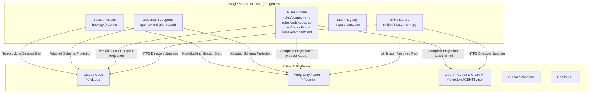

# agentrc: Centralized Multi-AI Configuration & Skill Hub

**`agentrc`** is a single-source-of-truth configuration and skill management system designed to unify rules (`CLAUDE.md`, `GEMINI.md`, `AGENTS.md`), executable skills (`SKILL.md` + Python scripts), subagents, MCP tool definitions, and lifecycle hooks across **Claude Code**, **Google Antigravity (AGY)**, **Cursor**, and other AI coding assistants.

---

## Architecture Overview



### Core Design Principles
1. **Zero Hallucination & Deterministic Projection**: AGY does not support `@import` markdown transclusion; `agentrc` deterministically compiles `GEMINI.md` with header guards.
2. **Host-Adapted Subagent Schemas**: Claude Code requires explicit tools (`Bash, Read, Edit...`) and model strings (`claude-haiku-5-5`); AGY rejects invalid tool keys and requires `inherit`/`pro`/`flash`. `agentrc` adapts schemas from universal templates.
3. **Safe Windows Linking**: Uses **NTFS Directory Junctions (`mklink /J`)** for folders (requiring zero administrator rights and immune to atomic rename breakage), rather than fragile hard links.
4. **Ultra-Lean Boot Footprint**: Strict token discipline maintains boot context under ~1,200 tokens across all tools via progressive disclosure.
5. **Preserve Multi-Agent Superpowers**: Platform bridges (such as Claude Code delegating image generation to `agy` or PR review to `copilot`) are categorized as first-class federation workflows in `rules/overrides/`.

---

## Directory Structure

```text
~/.agentrc/
├── agentrc.json             # Manifest & platform registration
├── rules/
│   ├── common.md            # Universal engineering heuristics (Surgical changes, Simplicity)
│   ├── code-tools.md        # CodeGraph, ripwire, ripgrep guidelines
│   ├── handoffs.md          # Session continuity & handoff lifecycle rules
│   └── overrides/           # Host-specific platform bridges
│       ├── claude.md        # Claude Code bridge (offload to agy, copilot review)
│       ├── agy.md           # Antigravity native capabilities
│       └── codex.md         # OpenAI Codex & ChatGPT overrides
├── skills/                  # Shared executable skills (SKILL.md + Python scripts)
│   ├── handoff/
│   ├── ripwire-*/
│   └── transcribe/
├── agents/                  # Universal subagent templates
│   ├── implementer.md
│   ├── reviewer.md
│   └── scout.md
├── mcp/
│   └── servers.json         # Single source MCP registry
├── export/                  # Consolidated prompt export for ChatGPT Web/Desktop
│   └── chatgpt_custom_instructions.md
└── backups/                 # Pre-migration whitelist snapshots
```

---

## CLI Commands

| Command | Description |
|---|---|
| `python agentrc.py detect` | Inspect and report installed AI tools and config paths. |
| `python agentrc.py init` | Scaffold `~/.agentrc/` hierarchy, copy templates, and run whitelist backup. |
| `python agentrc.py link` | Create NTFS junctions (`~/.claude/skills`) and update `~/.gemini/config/skills.json`. |
| `python agentrc.py project` | Deterministically project rules and host-adapted subagents. |
| `python agentrc.py doctor` | Audit link integrity, projection freshness, and drift (`--fix` auto-repairs). |
| `python agentrc.py budget` | Audit session startup token footprint against the 2,000 token ceiling. |
| `python agentrc.py hook session-start` | Fast (<10ms) non-blocking startup drift check. |

---

## Project Documentation
- **Architecture & Migration Plan**: [docs/centralized-ai-config-plan.md](docs/centralized-ai-config-plan.md)
- **Independent Architectural Review**: [docs/review-findings.md](docs/review-findings.md)
- **Current Handoff**: [handoffs/agentrc-phase1-implementation.md](handoffs/agentrc-phase1-implementation.md)
