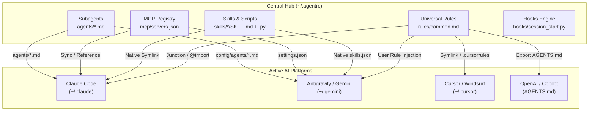
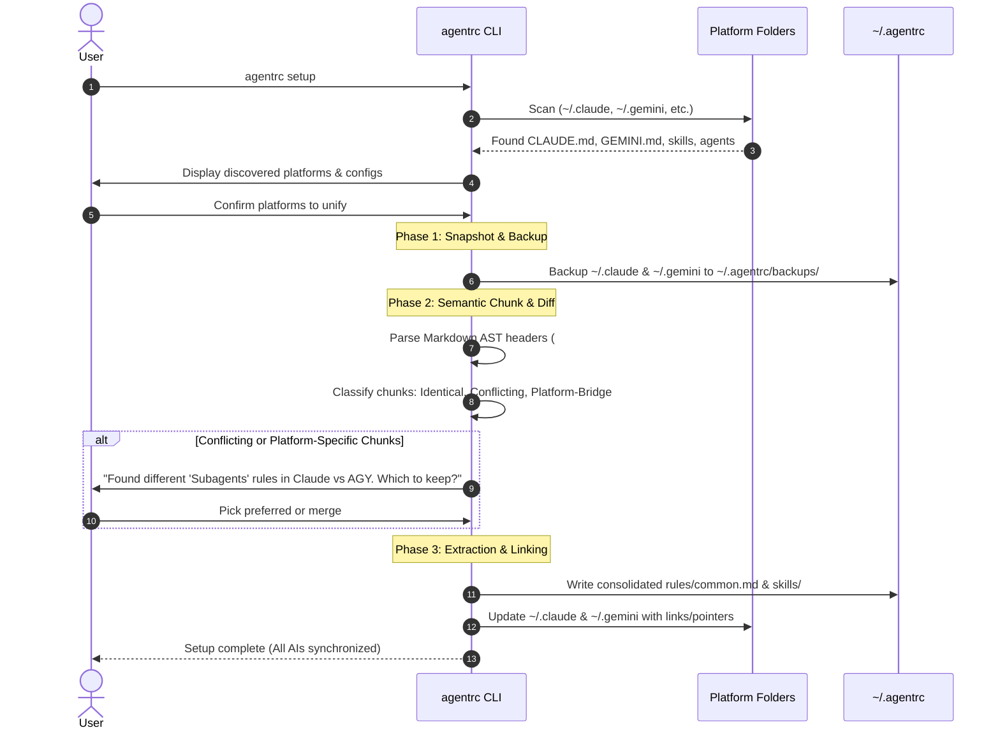
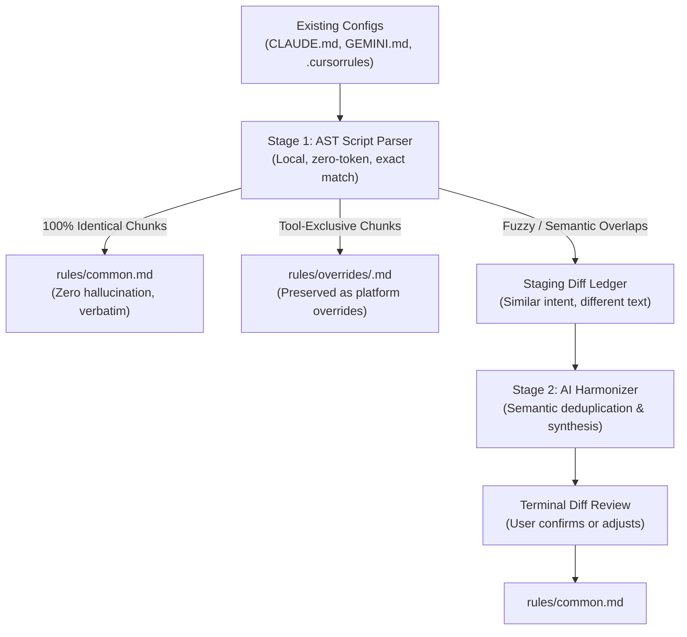
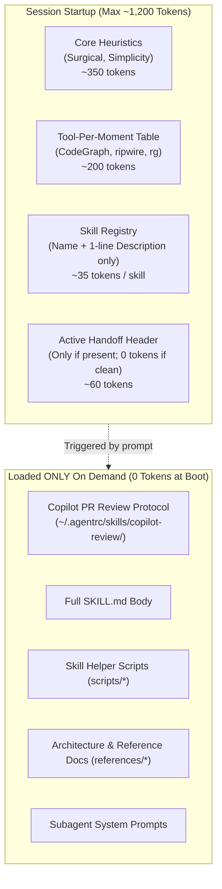
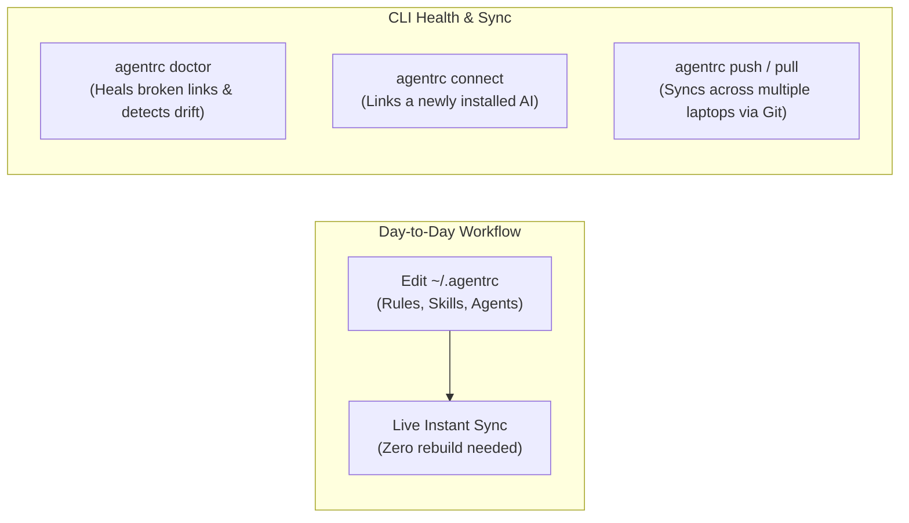

# Centralized Multi-AI Configuration Hub (`agentrc`)
## Architecture, Research, and Implementation Plan

This document outlines the architectural blueprint and execution plan for building a centralized, cross-platform configuration hub (**`agentrc`**, stored at `~/.agentrc`) that unifies rules, skills, agents, MCP tools, and hooks across **Claude Code**, **Google Antigravity (AGY)**, **Cursor**, **OpenAI / Codex**, and other AI coding assistants.

---

## 1. Industry Research & Existing Tools

We researched the open-source landscape to see how developers currently manage multi-assistant configuration drift:

| Tool | Core Approach | Strengths | Limitations / Gaps |
| :--- | :--- | :--- | :--- |
| **`dyoshikawa/rulesync`** | Build-time Code Generation | • Supports 10+ AI tools (Cursor, Claude, Copilot, Gemini CLI, etc.)<br>• Centralized `.rulesync/` source | • **Generate-only**: Overwrites targets on build; manual edits in an AI file get clobbered.<br>• Does **not** handle executable skills or script cross-compatibility.<br>• No migration wizard for existing setups. |
| **`ai-rulez`** | Go CLI compiler | • Fast, simple markdown compilation into `.cursorrules` and `copilot-instructions.md`. | • Narrow scope; rules only (no skills, subagents, or MCP). |
| **`cursor2claude`** | Unidirectional Syncer | • Syncs `.cursor/rules/` directly to `CLAUDE.md`. | • One-way and single-pair only. |
| **Traditional Dotfiles (`stow`, `chezmoi`)** | OS Symlinking | • Git-backed; battle-tested on Linux/macOS. | • **Fails on Windows**: Standard symlinks require Admin/Dev Mode.<br>• Schema-blind: cannot merge JSON manifests (like MCP or hooks). |

### The Opportunity: Why Build `agentrc`?
No tool today combines **Rule Unification**, **Executable Skills Parity** (Python vs. Bash), **MCP Registry Federation**, and a **Smart Migration Wizard** that resolves existing conflicting configs across tools.

---



---

## 2. Directory Structure of `~/.agentrc`

The centralized hub serves as the single source of truth:

```text
~/.agentrc/
├── agentrc.json                # Hub manifest & connected tools registry
├── rules/
│   ├── common.md               # Universal engineering guidelines (Simplicity, Surgical edits)
│   ├── code-tools.md           # Tool usage rules (CodeGraph, ripwire, ripgrep)
│   ├── handoffs.md             # Session continuity & handoff lifecycle rules
│   └── overrides/              # Platform-specific tweaks
│       ├── claude.md           # Overrides specific to Claude Code quirks
│       └── agy.md              # Overrides specific to Antigravity quirks
├── skills/                     # Agent Skills (SKILL.md + Python scripts)
│   ├── handoff/
│   ├── ripwire-*/
│   └── transcribe/
├── agents/                     # Shared subagent specs
│   ├── implementer.md
│   ├── reviewer.md
│   └── scout.md
├── mcp/
│   └── mcp_servers.json        # Single source for all MCP server configurations
└── backups/                    # Auto-backups created during migrations
```

---

## 3. How Each AI Platform Connects

To balance **zero-maintenance live sharing** with **host-specific schema constraints**, `agentrc` uses a hybrid of **directory junctions** (for skills) and **deterministic projection** (for rules and subagents):

### A. Google Antigravity (AGY / Gemini)
* **Skills (Direct Live Sharing)**: Configured in `~/.gemini/config/skills.json` using resolved absolute path:
  ```json
  { "entries": [{ "path": "C:/Users/habom/.agentrc/skills" }] }
  ```
* **Rules (Compiled Projection)**: Antigravity has no markdown transclusion engine (`@[]` is ingested verbatim as raw text). `agentrc` deterministically projects `~/.gemini/GEMINI.md` by concatenating:
  `rules/common.md` + `rules/code-tools.md` + `rules/handoffs.md` + `rules/overrides/agy.md`
  *(Includes header guard: `<!-- AUTOGENERATED BY AGENTRC - EDIT IN ~/.agentrc/rules/ -->`)*
* **Subagents (Host-Adapted Projection)**: Stored as universal templates in `~/.agentrc/agents/`. `agentrc` projects host-valid markdown files into `~/.gemini/config/agents/` (mapping models to `inherit`/`pro`/`flash` and omitting invalid tool keys).
* **Hooks**: `~/.gemini/config/hooks.json` points to the `agentrc` hook runner.

### B. Claude Code
* **Skills (Direct Live Sharing)**: NTFS Directory Junction (`mklink /J`) from `~/.claude/skills` to `~/.agentrc/skills`.
* **Rules (Live @import or Projection)**: `~/.claude/CLAUDE.md` uses Claude's native `@` import syntax (or compiled projection):
  ```markdown
  @~/.agentrc/rules/common.md
  @~/.agentrc/rules/code-tools.md
  @~/.agentrc/rules/handoffs.md
  @~/.agentrc/rules/overrides/claude.md
  ```
* **Subagents (Host-Adapted Projection)**: `agentrc` projects host-valid markdown files into `~/.claude/agents/` (mapping models to `claude-haiku-5-5`/`claude-sonnet-5-5` and injecting required tool strings like `Bash, Read, Edit...`).
* **Hooks (Settings Injection)**: Claude Code discovers hooks strictly via `~/.claude/settings.json` under `"hooks"`. `agentrc` updates `settings.json` to register the `SessionStart` command.

### C. Cursor & VS Code Copilot
* **Cursor**: Symlink/Junction user-level `.cursorrules` or export to project root.
* **Copilot**: Global instructions or `.github/copilot-instructions.md` referencing `rules/common.md`.

### D. OpenAI Codex & ChatGPT
* **Rules / Instructions (`AGENTS.md`)**:
  - OpenAI Codex CLI (`codex-cli`) and ChatGPT Projects use `AGENTS.md` as their native instruction standard.
  - `agentrc` projects global instructions into `~/.codex/AGENTS.md` by combining:
    `rules/common.md` + `rules/code-tools.md` + `rules/handoffs.md` + `rules/overrides/codex.md`
  - For ChatGPT Web / Desktop: `agentrc export chatgpt` produces a consolidated single prompt block ready to paste into ChatGPT Global Custom Instructions or ChatGPT Project instructions.
* **Skills (Direct Sharing)**:
  - NTFS Junction or symlink from `~/.agentrc/skills/` into `~/.codex/skills/`, making skills immediately discoverable by Codex CLI.
* **Subagents & Tool Collaboration**:
  - Codex uses built-in multi-turn tool calling and computer-use plugins. Universal subagent definitions in `~/.agentrc/agents/` are mapped to Codex runtime personas.
* **Platform Overrides (`rules/overrides/codex.md`)**:
  - Encapsulates Codex-specific nuances (e.g. attributing PR comments to Codex rather than Claude, avoiding RTK output wrapping, and handling computer-use permissions).

---

## 4. The Migration Wizard: Handling Existing Settings

The hardest engineering challenge is migrating a user who already has different rules in `~/.claude/CLAUDE.md` and `~/.gemini/GEMINI.md`.



### Rule Consolidation: Script vs. AI (The Hybrid Strategy)

How are common rules discovered across different files? Neither a pure script nor a pure AI prompt is sufficient on its own:
* **Pure Script alone is too brittle**: If Claude says `### 1. Think Before Coding\nDon't assume...` and Gemini says `## Guidelines\n- Think before coding: always clarify assumptions...`, a regex script fails to connect them.
* **Pure AI alone is too risky**: LLMs can subtly rewrite technical commands (mangling delicate flags like `shell(gh pr:*)` in Copilot CLI reviews), hallucinate nuances, or require external API keys.

`agentrc` uses a **Two-Stage Hybrid Engine**:



#### Stage 1: Deterministic AST Script (Zero-token, 100% safe)
1. **Section Tree Parser**: Parses markdown by header levels (`#`, `##`, `###`) into normalized blocks.
2. **Exact & Normalized Hash Matching**:
   * Hashes text after stripping whitespace and minor formatting.
   * If two blocks match verbatim (e.g. your *"1. Think Before Coding"* through *"4. Goal-Driven Execution"* rules), they are **automatically promoted to `rules/common.md` with zero risk of AI hallucination**.
3. **Preserves Verbatim Code Blocks**: Critical shell commands, regexes, and CodeGraph markers (`<!-- CODEGRAPH_START -->`) are locked so an AI cannot alter them.

#### Stage 2: AI Semantic Harmonizer (For messy overlaps)
For the remaining ~20% of rules that express the same intent in different words:
* An AI helper inspects the staged diffs:
  > *"Rule A in Claude (`Offload image generation to agy`) and Rule B in Gemini (`Use native image-generator`) describe the same intent. Suggestion: Keep Rule A in `overrides/claude.md` and Rule B in `overrides/agy.md`."*
* Presents a clean 3-way choice in the terminal:
  `[1] Accept AI synthesis into common.md`
  `[2] Keep separate in overrides/`
  `[3] Open in editor to review`

---

### Conflict Resolution & Multi-Agent Federation Strategy:
1. **Preserve Cross-Tool Bridges as Superpowers**:
   * Calling `copilot` from Claude/AGY or delegating image generation from Claude Code to `agy` is **deliberate multi-agent orchestration**.
   * `agentrc` will **never remove these workflows**.
   * Instead, it categorizes them into:
     * **Universal Integrations** (in `rules/common.md`): Used by all tools (e.g., *PR review with Copilot CLI* runs whether you're in Claude or AGY).
     * **Target-Specific Delegation** (in `rules/overrides/<tool>.md`):
       * `rules/overrides/claude.md` retains: *"Offload image generation & live search to `agy` CLI"*.
       * `rules/overrides/gemini.md` retains: *"Use native `image-generator` and `search_web`"*.
2. **Identical Heading Blocks**: Chunks like *"1. Think Before Coding"*, *"2. Simplicity First"* exist across both and are promoted to `rules/common.md`.
3. **Subagent Frontmatter Harmonization**:
   * Claude specs often hardcode `claude-sonnet-5-5` and bash tools.
   * AGY specs use `pro`, `flash`, or `inherit`.
   * The wizard keeps tools compatible with the host agent and generalizes model tiers (`smart` / `fast` / `inherit`).
4. **Script Polyfills**: Any Bash-only `.sh` scripts in skills are preserved alongside auto-generated Python equivalents so they work on both Windows and macOS/Linux.

---

## 5. Windows vs. Unix Linking & Projection Strategy

On Windows, creating file symlinks (`mklink`) often fails without Administrator privileges or Windows Developer Mode. Furthermore, hard links (`mklink /H`) are fragile because text editors sever them during atomic file saves (`write temp -> rename`). `agentrc` avoids these pitfalls:

1. **Native In-App Discovery (Zero Links)**: For AGY, use native JSON configs (`skills.json`) with resolved absolute paths.
2. **NTFS Directory Junctions (`mklink /J`)**: Junctions require **zero admin rights** on any Windows machine and work seamlessly for directory aliasing (e.g., linking `~/.claude/skills` ➔ `~/.agentrc/skills`).
3. **Deterministic Compiled Projection (Zero Hard Links)**: For standalone files (`GEMINI.md`, `CLAUDE.md`, and host-adapted subagents `agents/*.md`), `agentrc` generates/projects the file deterministically from `~/.agentrc` templates with header guards, avoiding atomic-rename breakage.

---

## 6. Token Economy & Ultra-Lean Startup Strategy

A central hub that dumps tens of files into the prompt at boot time will cause **prompt dilution**, high latency, and wasted tokens. `agentrc` enforces strict **token discipline** using a 4-tier model:



### The 5 Golden Rules of `agentrc` Token Discipline:

1. **Progressive Disclosure for Skills**:
   * At startup, **only** the YAML `name` and `description` are loaded into context.
   * A library of 20 skills consumes **less than 600 tokens total** at boot.
   * The actual instructions (`SKILL.md`), `scripts/`, and `references/` are loaded **only** when a prompt triggers that specific skill.

2. **Procedural Rules Offloaded to Skills**:
   * Multi-step procedures (such as the 35-line Copilot CLI PR review protocol) are packaged as **on-demand skills** (`skills/copilot-review/SKILL.md`) rather than inlined at startup.
   * `rules/common.md` is strictly limited to compact behavioral heuristics (Think before coding, Simplicity, Surgical changes, Code tool table), keeping core rules under ~400 tokens.

3. **Silent Hooks (<200ms Execution)**:
   * Startup hooks (like `session_start.py`) are non-interactive and **completely silent** when there is nothing to report (0 tokens).
   * When an active handoff exists, it emits **only the 3-line header** (~50 tokens), never the full handoff body.

4. **On-Demand Subagents**:
   * Subagent system prompts and tool declarations do **not** enter the main chat context.
   * They exist only in their isolated subagent session when explicitly spawned.

5. **Built-in Token Budget Auditor (`agentrc budget`)**:
   * `agentrc` includes a command to audit your boot footprint:
     ```text
     $ agentrc budget
     Target: Claude Code    | Boot tokens: 1,020 / 2,000 (PASS - LEAN)
     Target: Antigravity    | Boot tokens:   980 / 2,000 (PASS - LEAN)
     - Core rules: 380 tokens
     - Skill registry (18 skills): 540 tokens
     - Active handoff: 0 tokens (silent)
     ```
   * Warns immediately if any rule or description pushes boot context over the budget.

---

## 7. Day-2 Operations & Lifecycle Maintenance

After the initial setup, you never want to re-run complex migrations. `agentrc` is designed for **near-zero day-to-day maintenance**:



### 1. Day-to-Day Editing (Instant, Zero-Friction)
Because `agentrc` uses **live references** (NTFS directory junctions on Windows, native `skills.json` paths, and `@import` statements), you never need to run a "compile" or "sync" command after editing:
* **Add a rule**: Edit `~/.agentrc/rules/common.md`. Claude, AGY, and Cursor pick it up on their next prompt.
* **Add a skill**: Drop a new skill folder into `~/.agentrc/skills/<name>/`. It is immediately discoverable by every tool.

### 2. Drift Detection & Self-Healing (`agentrc doctor`)
AI tools occasionally update themselves and might reset config directories. Running `agentrc doctor`:
* Verifies all junction points and configuration entries are intact.
* Checks if any file was accidentally edited directly in `~/.claude` or `~/.gemini` instead of `~/.agentrc`.
* Auto-repairs broken links with `agentrc doctor --fix`.

### 3. Onboarding a New AI Assistant (`agentrc connect <tool>`)
If you install a new assistant next month (e.g., Cursor, Windsurf, or Codex CLI):
* Run `agentrc connect cursor`.
* In 2 seconds, it links Cursor's rule paths to your existing `~/.agentrc` hub without touching your other setups.

### 4. Multi-Machine Sync (`agentrc push` / `pull`)
`~/.agentrc` is initialized as a standard Git repository:
* **Work machine**: Tweak a rule ➔ `agentrc push` (commits and pushes to your private GitHub repo).
* **Laptop**: `agentrc pull` ➔ all your tools on the laptop are instantly up to date.

### 5. Zero-Touch Automatic Sync (`SessionStart` Hook)
To ensure downstream additions (e.g., `claude mcp add`) synchronize automatically without manual intervention:
* `agentrc` registers a 5ms lightweight `SessionStart` hook in both `~/.claude/` and `~/.gemini/config/hooks.json`.
* Every time any session launches, the hook compares modification timestamps (`mtime`) of `~/.claude.json`, `~/.gemini/settings.json`, and `~/.agentrc/agentrc.json`.
* If a new MCP tool or configuration is detected, it is immediately ingested into `~/.agentrc` and mirrored to peer tools before the prompt runs.
* **Cost**: ~5ms execution time, 0 tokens, 0 background daemon RAM.

---

## 8. Downstream Mutation & Desync Defenses

In real-world multi-agent environments, assistants or tools may mutate configurations out-of-band. `agentrc` includes specific defenses against 5 failure modes:

| Scenario / Threat | How Desync Could Happen | Built-in `agentrc` Defense |
| :--- | :--- | :--- |
| **1. AI Self-Editing** | User tells Claude: *"Always use pnpm"*; Claude modifies `CLAUDE.md` directly. | • Symlink/Junction routes the edit straight into `~/.agentrc/rules/common.md`.<br>• Header guard detects any text appended below `@import` and prompts promotion. |
| **2. Atomic File Renames** | Editors/npm write to `settings.json.tmp` then rename, severing file hard links. | • Folder-level junctions (`~/.claude/skills/`) are immune to file renames.<br>• JSON configs use timestamp-based parse & merge, never file hard links. |
| **3. Concurrent Split-Brain** | Claude and AGY open concurrently; user adds conflicting MCP configs to both. | • Hook detects dual-sided `mtime` updates newer than `~/.agentrc`.<br>• Flags conflicting keys and prompts user resolution instead of silent clobber. |
| **4. Deletion Ambiguity** | User runs `claude mcp remove foo`. (Delete locally or globally?) | • Tombstone tracking asks: *"Remove globally or keep as tool override?"* |
| **5. App Updates / Reinstalls** | Package manager or update wipes `.claude/skills` or `.gemini`. | • `~/.agentrc` is completely isolated outside tool directories.<br>• Next `SessionStart` detects missing junction and auto-heals it in 5ms. |

---

## 9. Implementation Roadmap

### Phase 1: Core Engine & Directory Linking (`agentrc.py` / `arc`)
- Standalone Python 3 script (standard library only, zero dependencies).
- Platform detector: checks `~/.claude`, `~/.gemini`, `~/.cursor`.
- Directory initializer: creates `~/.agentrc/` with `rules/`, `skills/`, `agents/`, `mcp/`, `hooks/`.
- Safe Windows link manager: creates NTFS directory junctions (`mklink /J`) and updates `skills.json`.
- Windows launcher: `agentrc.bat` so it runs natively from CMD and PowerShell.

### Phase 2: Hybrid Migration Wizard
- Deterministic Markdown AST chunker: splits by header trees.
- Exact match promoter: automatically promotes 100% identical sections into `rules/common.md`.
- Platform bridge classifier: preserves Claude ➔ AGY image generation and Copilot PR reviews into `rules/overrides/`.
- Automated pre-migration snapshot: backs up all existing files to `~/.agentrc/backups/<tool>-<date>/`.

### Phase 3: Zero-Touch Automation & Diagnostics
- `agentrc hook session-start`: 5ms timestamp comparator and JSON merger.
- Wire into `~/.claude/hooks/` and `~/.gemini/config/hooks.json`.
- `agentrc doctor`: Link health verification, drift detection, and `--fix` auto-repair.
- `agentrc budget`: Token footprint auditor across all connected tools.

### Phase 4: Git Dotfile Federation
- Initialized Git repository in `~/.agentrc`.
- `agentrc push` and `agentrc pull` commands for cross-machine synchronization.
